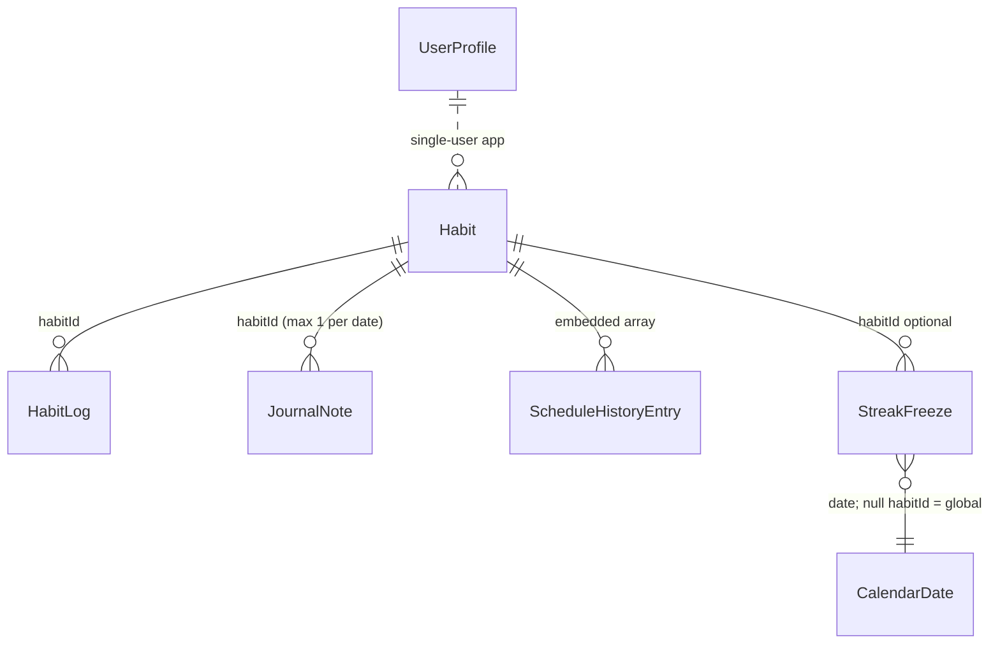

# HabitFlow — Architecture Documentation

**Version:** 1.0 (Phase 1) — documents the **actual** implemented architecture. Nothing here is aspirational; known defects are cross-referenced to `AUDIT.md`.

---

## 1. Technology Stack (verified)

| Layer | Technology | Notes |
|---|---|---|
| Build tool | **Vite 8** (`@vitejs/plugin-react`) | Dev server on port 3000; `@` alias → project root; HMR optionally disabled via `DISABLE_HMR` (AI Studio artifact) |
| UI framework | **React 19** | Function components + hooks only; no router, no state library |
| Language | **TypeScript** (`^7.0.2`), `noEmit`, bundler resolution | `npm run lint` = `tsc --noEmit` |
| Styling | **Tailwind CSS v4** via `@tailwindcss/vite` | CSS-first config: `@theme` block in `src/index.css`; **no tailwind.config.js** |
| Icons | `lucide-react` | |
| Celebration FX | `canvas-confetti` | |
| Audio | Web Audio API (procedural oscillators) | No audio assets |
| Persistence | `localStorage` (+ `sessionStorage` for reminder dedupe) | **No IndexedDB usage anywhere** |
| Offline | Hand-written Service Worker `public/sw.js` | No Workbox |
| Testing | `node:test` + `node:assert/strict` (`src/domain/domain.test.ts`) | No npm test script wired |
| Unused scaffolding ⚠️ | `@google/genai`, `express`, `dotenv`, `motion`, `esbuild`, `tsx`, `@types/express` | AI Studio template leftovers, not imported by app code — see AUDIT.md |

There is **no Next.js, no SSR, no backend**. `index.html` is a plain SPA shell; `src/main.tsx` mounts `<App/>` and registers the Service Worker.

## 2. High-Level Architecture

```
┌────────────────────────────────────────────────────────────┐
│ index.html (SPA shell, dark class, Google Fonts links)     │
│ main.tsx  → createRoot(App) + SW registration              │
├────────────────────────────────────────────────────────────┤
│ PRESENTATION — src/App.tsx (single stateful root)          │
│   • All application state as useState in App               │
│   • Tab router, modal orchestration, all event handlers    │
│   • src/components/* (14 presentational components)        │
├────────────────────────────────────────────────────────────┤
│ DOMAIN — src/domain/* (pure functions, zero React/storage) │
│   date.ts • schedule.ts • streak.ts • analytics.ts         │
│   + notifications/service.ts (side-effecting utility)      │
│   + utils/confetti.ts (side-effecting utility)             │
├────────────────────────────────────────────────────────────┤
│ STORAGE — src/storage/*                                    │
│   localStorage.ts (repository + seeding + cross-tab sync)  │
│   schema.ts (defaults, validation, migration, merge)       │
├────────────────────────────────────────────────────────────┤
│ TYPES — src/types/index.ts (all interfaces + CATEGORIES)   │
├────────────────────────────────────────────────────────────┤
│ PLATFORM — public/sw.js, public/manifest.json, icons       │
└────────────────────────────────────────────────────────────┘
```

Data flow is **one-directional per action**: component event → App handler → domain helpers compute derived values → handler updates React state **and** writes through `LocalStorageRepository` synchronously. There is no effect-based persistence; every mutation handler persists immediately. Derived metrics (streaks, rates, heatmaps) are **recomputed during render** — nothing is cached or stored.

## 3. Component Structure (`src/components/`)

| Component | Role | Key props |
|---|---|---|
| `HeroHeader` | Greeting, date line, 3 stat cards w/ SVG ring, Freeze + New Habit actions | `userName, selectedDate, completionRate, currentStreak, activeHabitsCount, completedTodayCount, isHolidayMode` |
| `DateCarousel` | 16-day chip scroller (T−14…T+1) with status dots, prev/next, Today pill | `selectedDate, onSelectDate, habits, logs, freezes` |
| `HabitCard` | Daily execution row: checkbox, streak pill, status badges, ⋮ menu, journal footer | full entity set + 6 callbacks (toggle complete/note/freeze/edit/archive/delete) |
| `HabitModal` | Create/edit form (title, category, 3 schedule types, target, reminder, notes) | `isOpen, onClose, onSave(Partial<Habit>), initialHabit` |
| `MicroJournalModal` | 160-char note editor with quick prompts | `habit, dateStr, initialNote, onSaveNote, onDeleteNote` |
| `FreezeModal` | Holiday Mode activation/deactivation with reasons + allowance display | `selectedDate, isGloballyFrozen, remainingAllowance, onToggleGlobalFreeze` |
| `HeatmapAnalytics` | Heatmap (3/6/12mo), WoW & MoM cards, category breakdown, tooltip | `habits, logs, freezes, onSelectDate` |
| `SettingsModal` | Profile, freeze allowance, notifications, chimes, archive toggle, backup link, reset | `profile, onUpdateProfile, onResetData, onOpenBackupModal, showArchived…` |
| `BackupModal` | Export download; import with validation → merge/replace → rollback | `onDataRestored` |
| `OnboardingModal` | First-run name/age (+ starter-habit list ⚠️ Phase 2 removal) | `onComplete(profile, habits)` |
| `PWAInstallButton` | Adaptive header install affordance (hidden / direct / iOS guide / modal opener) | `onOpenModal` |
| `PWAInstallModal` | Platform-tabbed install instructions | — |
| `usePWAInstall` (hook) | Captures `beforeinstallprompt`, detects standalone & iOS | — |
| `OfflineIndicator` | Amber offline toast via `online`/`offline` events | — |

**State ownership:** `App.tsx` is the single source of truth (`profile, habits, logs, notes, freezes` + UI state: `activeTab, selectedDate, categoryFilter, showArchived`, 7 modal flags). Components are otherwise stateless apart from local form/UI state. This is a deliberate "lifted state root" pattern — acceptable at this app size; there is no context, reducer, or external store.

## 4. Domain Layer (`src/domain/`)

Pure, timezone-safe business logic. No DOM, no React, no storage imports.

### 4.1 `date.ts` — local-first calendar utilities
- `toLocalDateString()` → `YYYY-MM-DD` from local components (never UTC slicing).
- `fromLocalDateString()` parses anchored at **noon local** to survive DST boundaries.
- `shiftDate()`, `getPastDates()`, `formatDisplayDate()` (Today/Yesterday/Tomorrow special-cases via `Intl.DateTimeFormat`).
- `getLocalGreeting()` — morning/afternoon/evening copy.
- Monday-start week helpers: `getCalendarWeekDates()`, ISO-style `getCalendarWeekKey()` ("2026-W45").

### 4.2 `schedule.ts` — scheduling resolution
- `resolveScheduleForDate(habit, date)` — replays `scheduleHistory` revisions: merges history with an implicit "current schedule effective from `updatedAt` date" entry, sorts by `effectiveFrom`, picks the latest revision ≤ date (falls back to the earliest). ⚠️ Combined with the App-layer history-recording bug (new schedule stored instead of old), historical resolution is currently unreliable — AUDIT.md BUG-3.
- `isHabitScheduledForDate()` — false before `createdAt` day, false after `archivedAt` day; `daily` → always; `specific_days` → weekday membership (default Mon–Fri); `times_per_week` → every day eligible.
- `isPlannedRestDay()` — `specific_days` non-member days.
- `isEligibleInstance()` — the **rate denominator rule**: scheduled ∧ ¬rest ∧ ¬frozen.
- `getWeeklyCompletionsCount()` — completions inside the Monday-start week of a date.

### 4.3 `streak.ts` — streak engine
- Primitives: `isHabitCompleted`, `isHabitFrozen` (global freeze has `habitId === undefined` and matches every habit), `resolveHabitDailyStatus` (4-state: completed → frozen → skipped → missed precedence).
- `calculateConsecutiveDayStreak` — backward walk ≤365 days from reference date; skips rest/unscheduled; completed +1; frozen preserves (no +1); missed breaks. An incomplete *today* does not reset (walk starts at yesterday). Longest streak audited over a separate 180-day forward pass.
- `calculateWeeklyTargetStreak` — consecutive Monday-start weeks meeting `targetCount`; any freeze inside a week preserves it; `streakUnit:'weeks'`. ⚠️ `longestStreak` approximated as `max(current,1)`.
- `calculateHabitStreak` — facade dispatching on schedule type.
- `calculateGlobalStreak` — app-wide: today-rate over eligible instances; day counts if ≥1 eligible completion; zero-eligible or globally-frozen days skipped; fully-missed day breaks. ⚠️ Same longest-streak approximation.
- Freeze accounting: `getUniqueFrozenDatesCount(freezes, 'YYYY-MM')` (distinct dates, global or per-habit, each date costs 1) and `getRemainingFreezeAllowance()` (auto-resets monthly). ⚠️ Display-only; not enforced at write time (AUDIT.md BUG-4).

### 4.4 `analytics.ts` — analytics engine
- `calculatePercentageHeatmap(habits, logs, freezes, daysCount=119, end=today)` → `HeatmapDay[]` with `completedCount / eligibleCount / percentage / isFrozen / intensity 0–4` (0%, 1–39, 40–74, 75–99, 100 bands; intensity 0 forced when nothing completed).
- `calculateCategoryBreakdown(days=30|7)` → per-category active/completed/scheduled/rate.
- `calculateStatsForDates(dates[])` → aggregate over arbitrary date lists.
- `calculateWeekOverWeekComparison` / `calculateMonthOverMonthComparison` → `PeriodComparisonStat` with `rateDelta` in percentage points. Current week/month include future days (they count as scheduled-incomplete) — documented behavior.
- `getBestPerformingCategory` — highest rate, tie-break by completions, requires scheduled > 0.

### 4.5 Supporting utilities (side-effecting, outside `domain/`)
- `notifications/service.ts` — Notification API feature detection, permission request, `sendLocalNotification` (prefers `registration.showNotification` when a SW controller exists, falls back to `new Notification`), `checkHabitReminders(habits)` (HH:MM exact-minute match against local clock, per-day dedupe in `sessionStorage['habitflow_reminded_<date>']`), and `playChime('success'|'streak'|'freeze')` — procedural Web Audio oscillator envelopes, no assets.
- `utils/confetti.ts` — `triggerStreakCelebration()` (single burst) and `triggerAllCompletedCelebration()` (1.2s two-sided stream). No reduced-motion guard ⚠️.

## 5. Storage Repository (`src/storage/`)

### 5.1 localStorage responsibilities (the ONLY persistent store)

| Key | Content |
|---|---|
| `habitflow_profile_v2` | `UserProfile` |
| `habitflow_habits_v2` | `Habit[]` |
| `habitflow_logs_v2` | `HabitLog[]` |
| `habitflow_notes_v2` | `JournalNote[]` |
| `habitflow_freezes_v2` | `StreakFreeze[]` |
| `habitflow_schema_version` | Declared in `STORAGE_KEYS` but **never read or written** ⚠️ |
| `habitflow_corrupted_<key>_<ts>` | Quarantine copies of unparseable payloads |
| Legacy v1: `habitflow_profile/habits/logs/freezes` | Read once, migrated, rewritten under v2 keys |

`sessionStorage`: `habitflow_reminded_<date>` (reminder dedupe only — keys accumulate daily, never pruned ⚠️).

**Explicit non-usage:** the app uses **no IndexedDB** and stores no user data in CacheStorage.

### 5.2 Repository hardening (`LocalStorageRepository`)
- `safeParseJSON` — corrupt payloads are copied to quarantine keys and replaced with typed fallbacks instead of crashing.
- `safeSetItem` — catches `QuotaExceededError` / `NS_ERROR_DOM_QUOTA_REACHED`, logs, returns false (writes are fire-and-forget; callers do not surface failures to the UI ⚠️).
- `subscribeToCrossTabSync` — `storage` event listener on the five v2 keys; App reloads all stores on change.
- `generateUniqueId(prefix)` — `crypto.randomUUID()` with timestamp+random fallback.
- Snapshot/rollback: `createStorageSnapshot()` (= `exportFullBackup()`) and `rollbackToSnapshot()` used by BackupModal's atomic import.
- Seeding helpers `getInitialStarterHabits()` / `getInitialSeedHistory()` — starter template + randomized 21-day demo history. Used by onboarding, the empty-store hydration fallback, `?autostart=1` demo mode, and Settings reset. ⚠️ Phase 2 removes all four call sites (PRD §2.2).

### 5.3 Schema versioning & migration (`schema.ts`)
- `CURRENT_SCHEMA_VERSION = 2`; exported payloads carry `{schemaVersion, appVersion:'2.0.0', exportedAt}`.
- `DEFAULT_PROFILE` provides fallbacks for every profile field.
- `validateBackupPayload(rawText)` — JSON parse; requires object with `habits` and `logs` arrays; missing `schemaVersion` treated as 1; returns count summary for the preview UI. Validation is structural, not per-record ⚠️.
- `migrateBackupPayload(raw)` — v1→v2 normalization: backfills stable ids (`habit-<ts>-<idx>` etc.), coerces types, `frequency`→`schedule` rename tolerance, extracts v1 notes embedded in logs into the notes store, merges profile over defaults. Also reused for legacy localStorage key migration.
- `mergeBackupWithState(existing, incoming)` — habits unioned by id (newer `updatedAt` wins; schedule histories concatenated), logs/notes deduped by `habitId_date` (incoming wins), freezes by `date_habitId|all`; children of unknown habits dropped (referential integrity). Profile is **not** merged ⚠️.

## 6. Data Models (`src/types/index.ts`)

Entity relationships:



- **Habit** — `id, title, category(5 enum), schedule{type: daily|specific_days|times_per_week, days?[0-6], targetCount?1-7}, scheduleHistory?, targetUnit?, reminderTime?('HH:MM'), notes?, createdAt/updatedAt(ISO), archived?, archivedAt?`.
- **HabitLog** — `id, habitId, date('YYYY-MM-DD' local), completed, completedAt?`. Uniqueness per (habitId, date) enforced by handlers, not the store.
- **JournalNote** — `id, habitId, date, note(≤160), createdAt, updatedAt`. One per (habitId, date).
- **StreakFreeze** — `id, date, habitId?(undefined = Holiday Mode/global), reason, createdAt`.
- **UserProfile** — `name, age?(5–120|''), onboardingCompleted, theme('dark'|'light'|'system' — only dark implemented), freezeAllowance(default 3), soundEnabled, notificationsEnabled, notificationDisclaimerAcknowledged?(stored, never used ⚠️)`.
- **Derived view models** (never persisted): `DailyStatus`, `HabitDayState`, `HeatmapDay`, `CategoryStat`, `PeriodComparisonStat`, `StreakMetrics`, `BackupPayload`, `BackupValidationResult`.

All dates are **local calendar strings** (`YYYY-MM-DD`); all timestamps ISO 8601. Day-of-week convention: `0=Sun … 6=Sat`; weeks start Monday.

## 7. Historical Schedule Handling

Intent: editing a habit's schedule must not rewrite history — past dates should evaluate against the schedule that was active then.

Mechanism: `Habit.scheduleHistory: {effectiveFrom, schedule}[]` + `resolveScheduleForDate()` replay (see §4.2). The App-layer edit handler (`handleSaveHabit`) is responsible for appending revisions when `JSON.stringify(new.schedule) !== JSON.stringify(old.schedule)`.

**Current defect:** the handler appends the **new** schedule with `effectiveFrom = today` instead of archiving the **old** schedule with its original effective date, and `resolveScheduleForDate` additionally synthesizes a "current schedule effective from `updatedAt`" entry. Net effect: dates before the edit resolve to the new schedule (or the earliest revision), so historical accuracy is not actually achieved. Tracked as AUDIT.md BUG-3 with the fix direction.

## 8. Notification & Reminder Architecture (and its limits)

- **Trigger source:** `App.tsx` effect — `checkHabitReminders(habits)` immediately after hydration, then every **30 000 ms** while the tab lives. Matching is exact `HH:MM` string equality against the local clock, deduped per day in sessionStorage.
- **Delivery:** Notification permission requested only from SettingsModal. With a controlling Service Worker → `registration.showNotification` (icon, badge, tag `habitflow-reminder`); otherwise `new Notification()`. Unsupported/denied → silent no-op.
- **SW side:** `notificationclick` focuses an existing window or opens `/`. There is **no `push` event listener** and no push subscription — true background push is architecturally absent by design (local-first, no server).
- **Hard limitations (documented in UI):** reminders only fire while the app is open (foreground or backgrounded tab subject to timer throttling); a missed minute is never retried; mobile OS may suspend timers entirely. The Settings banner discloses this honestly; PRD keeps server push out of scope.

## 9. Service Worker Architecture (`public/sw.js`)

- **Cache:** single versioned cache `habitflow-cache-v2`.
- **install:** precache app shell (`/`, `/index.html`, `/manifest.json`, icons); partial failure tolerated; `skipWaiting()`.
- **activate:** delete all non-current caches; `clients.claim()`.
- **fetch (GET only):**
  - `mode === 'navigate'` → **network-first**; success cloned into cache; failure → cached `/index.html` → `/`.
  - Everything else → **cache-first**; network misses cached at runtime only when `response.status === 200 && response.type === 'basic'` (same-origin) — so cross-origin Google Fonts are never cached ⚠️; the network-failure branch returns the (undefined) `cached` variable, i.e. the request simply fails offline for uncached assets ⚠️.
  - Stale hashed JS/CSS bundles from previous builds accumulate in the cache (only cleared on cache-name bump) ⚠️.
- **Registration:** `main.tsx` on `load`, scope `/`, console-logged outcome.
- **Cache name bumping is manual** — deploy process must edit `CACHE_NAME` to invalidate.

### Storage responsibility split (explicit)

| Mechanism | Responsibility |
|---|---|
| **localStorage** | All user data (profile, habits, logs, notes, freezes), schema/migration state, corruption quarantine |
| **sessionStorage** | Ephemeral per-tab reminder dedupe only |
| **IndexedDB** | **Not used** |
| **CacheStorage** | App-shell + static asset caching for offline load ONLY — never user data |

## 10. Data Backup & Recovery Architecture

Export: `exportFullBackup()` reads all five stores fresh from localStorage (not React state) → `BackupPayload` v2 → Blob → programmatic `<a download>` → `URL.revokeObjectURL`.

Import: file text → `validateBackupPayload` → user picks merge/replace → `createStorageSnapshot()` (pre-image) → `migrateBackupPayload` → write path (replace: all five stores incl. profile; merge: four entity stores via `mergeBackupWithState`, profile untouched ⚠️) → success: `onDataRestored()` re-hydrates App state from storage; failure: `rollbackToSnapshot()` restores the pre-image and surfaces the error.

Cross-tab consistency: because both snapshot and restore go through the repository, the `storage`-event subscription propagates restored data to other open tabs.

## 11. Build, Quality & Deployment Notes

- Scripts: `dev` (Vite, port 3000), `build`, `preview`, `lint` (`tsc --noEmit`), `clean`. **No `test` script** despite `src/domain/domain.test.ts` (runnable via `node --test` with a TS loader) ⚠️.
- No CI configuration, no ESLint/Prettier config, no error boundary, no router (single-view app).
- `README.md` is the unmodified AI Studio template; `package.json` name is `react-example`; `.env.example`/`metadata.json` reference an unused Gemini API ⚠️ — all cleanup tracked in AUDIT.md.
- Static deploy target: any origin serving `dist/` over HTTPS (SW + PWA require secure context).
