# HabitFlow — Complete User Journey & Flow Documentation

**Version:** 1.0 (Phase 1)
Flows describe the app as implemented in source. Onboarding (Section 1) documents the **Phase 2 target flow** (name + age only, empty dashboard); the current implemented deviation is noted inline and detailed in `AUDIT.md`.

---

## 0. Global Navigation Model

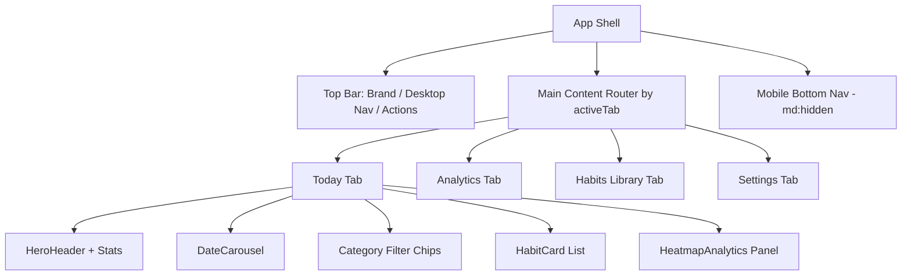

- Tabs: `today | analytics | manage | settings`, switched via header nav (desktop) or bottom nav (mobile). Bottom nav "Settings" opens the Settings **modal** directly instead of the settings tab.
- Every tab keeps the HeroHeader visible; `selectedDate` is global state shared by Today, carousel, freeze modal, and journal modal.

---

## 1. First-Time Onboarding

**Entry:** App hydration finds `profile.onboardingCompleted === false` (and no `?autostart=1` flag) → OnboardingModal opens (non-dismissible full-screen overlay).

**Target flow (Phase 2):**

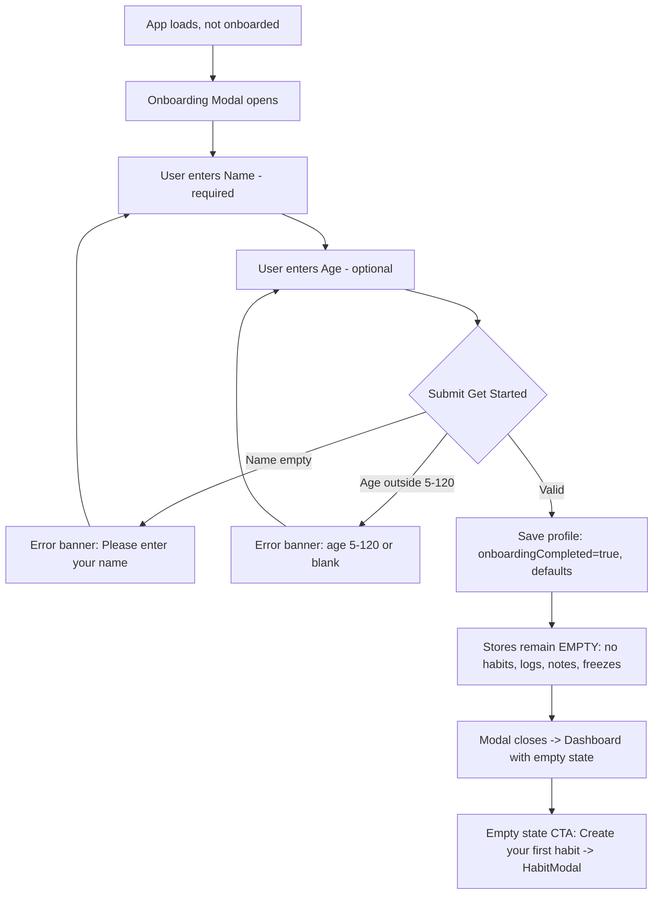

- **Validation:** name non-empty after trim; age blank or integer 5–120. Errors render as a rose banner at the top of the form and clear on the next keystroke.
- **Success:** profile persisted (`theme:'dark'`, `freezeAllowance:3`, `soundEnabled:true`, `notificationsEnabled:false`); no habits seeded.
- **Current implemented deviation:** the modal also shows a "Choose Starter Habits" list; on completion it seeds the chosen starter habits **plus 21 days of randomized fake logs, a demo note, and a demo freeze**, then fires confetti. (The selection UI is itself broken — IDs never match — so 3 habits are always seeded. See AUDIT.md BUG-1/BUG-2.) This entire branch is removed in Phase 2.

---

## 2. Main Dashboard (Today Tab)

**Layout order:** HeroHeader → (12-col grid) left: DateCarousel card → category filter chips → habit cards; right: heatmap/analytics panel.

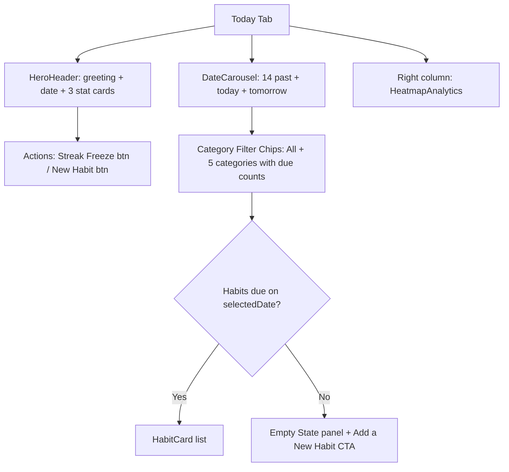

- **Greeting:** Morning 05–11:59 / Afternoon 12–17:59 / Evening otherwise; name gradient; "Live Today" vs "Historical Log" pill.
- **Due list:** active (non-archived) habits scheduled for `selectedDate`, filtered by selected category.
- **Stat cards:** completion % of *eligible* instances + progress ring; global streak; active habit count.

---

## 3. Empty Dashboard State

Two distinct empty states:

1. **First-run empty (Phase 2 target):** zero habits exist → encouraging panel: icon tile, "Your journey starts now" style headline, explanatory copy, primary CTA **Create your first habit** → opens HabitModal in create mode.
2. **No-habits-due empty (implemented):** habits exist but none scheduled for the selected date/filter → `CheckCircle2` tile, "No habits scheduled for this date", context copy (category filter vs free schedule), soft-emerald "Add a New Habit" CTA.

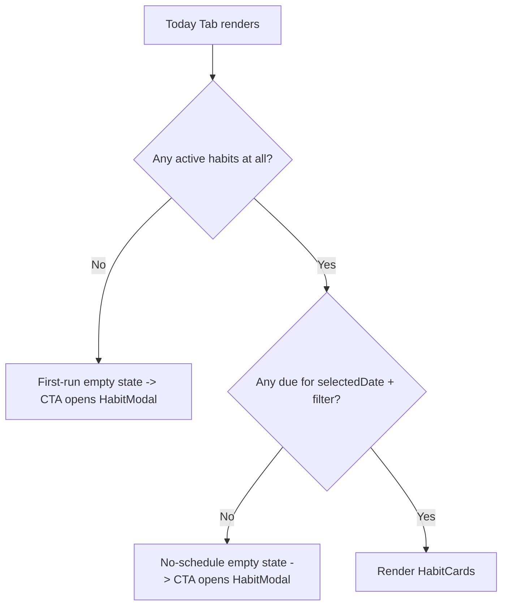

---

## 4. Daily Habit Execution

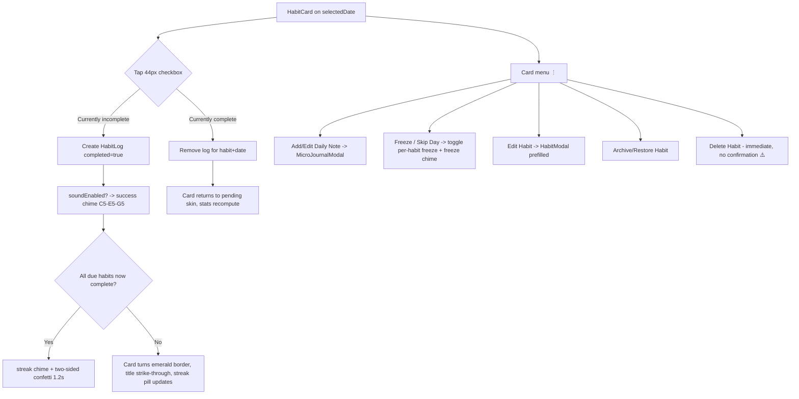

**Card visual states:** pending (slate) → completed (emerald border, strike-through) → frozen (sky border, shield checkbox, "Streak Frozen" badge) → planned rest (dimmed, moon icon, "Planned Rest" badge) → missed (amber border, "Missed" badge, past dates only).

**Date navigation:** prev/next arrows step one day; chips scroll & auto-center; "Today" pill returns to the current date. Selecting a past date enables back-dating completions and freezes; the hero shows "Historical Log".

---

## 5. Habit Creation

**Entries:** header "Add Habit" button, hero "New Habit" button, empty-state CTAs, library "Create Habit" button — all open HabitModal with `initialHabit = null`.

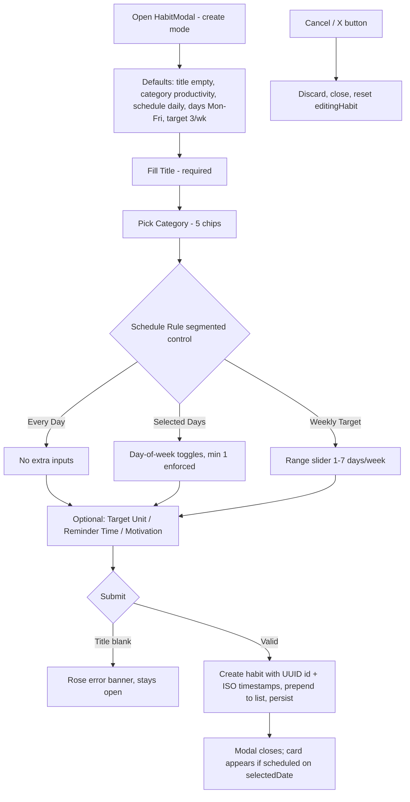

---

## 6. Habit Editing

**Entries:** card menu → Edit Habit; library card gear button. Opens the same modal prefilled (`initialHabit` set); title becomes "Edit Habit", submit "Save Changes".

- On save: fields merged, `updatedAt` refreshed.
- **Schedule change intent:** previous schedule should be pushed to `scheduleHistory` effective from today so historical dates keep resolving against the rule that was active then. ⚠️ Current code pushes the *new* schedule into history instead (AUDIT.md BUG-3) — flows should be re-verified after the fix.
- Cancel/X discards changes silently (no unsaved-changes prompt).

---

## 7. Habit Library (Manage Tab)

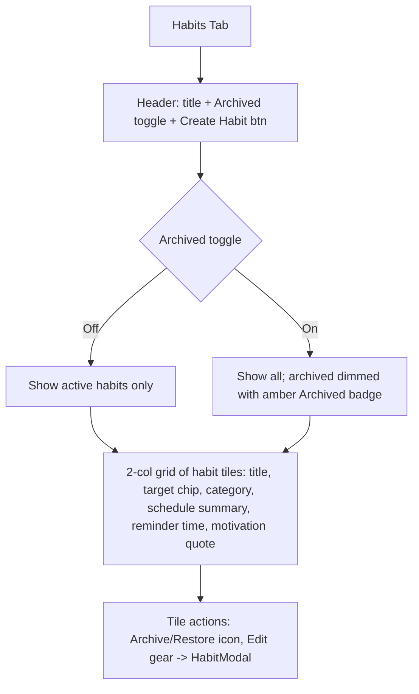

- Schedule summary labels: "Every Day" / "{n} specific days" / "{n} days/wk".
- Archived tiles: `opacity-70`, restore via the same archive action.
- Deletion is only available from the Today-tab card menu (not the library) — ⚠️ inconsistency noted in AUDIT.md.

---

## 8. Micro-Journaling

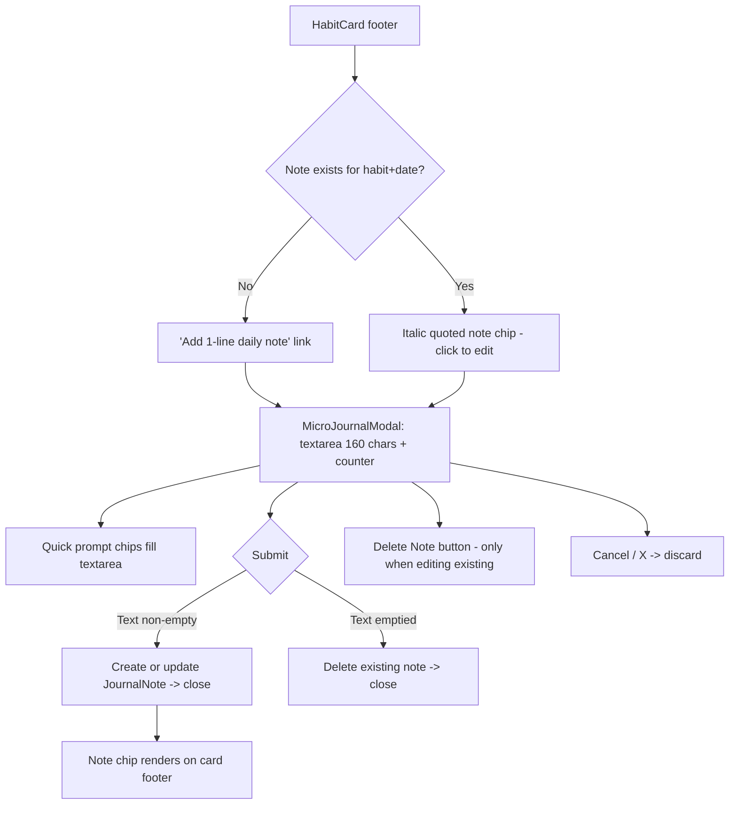

- Notes are independent of completion state; one note per (habit, date).

---

## 9. Streak Freeze & Holiday Mode

**Per-habit freeze** (quick path): card menu → "Freeze / Skip Day" toggles a freeze record `{date, habitId, reason:'Rest / Skip Day'}` + freeze chime. Menu label flips to "Unfreeze Day". Card switches to frozen skin.

**Holiday Mode** (global):

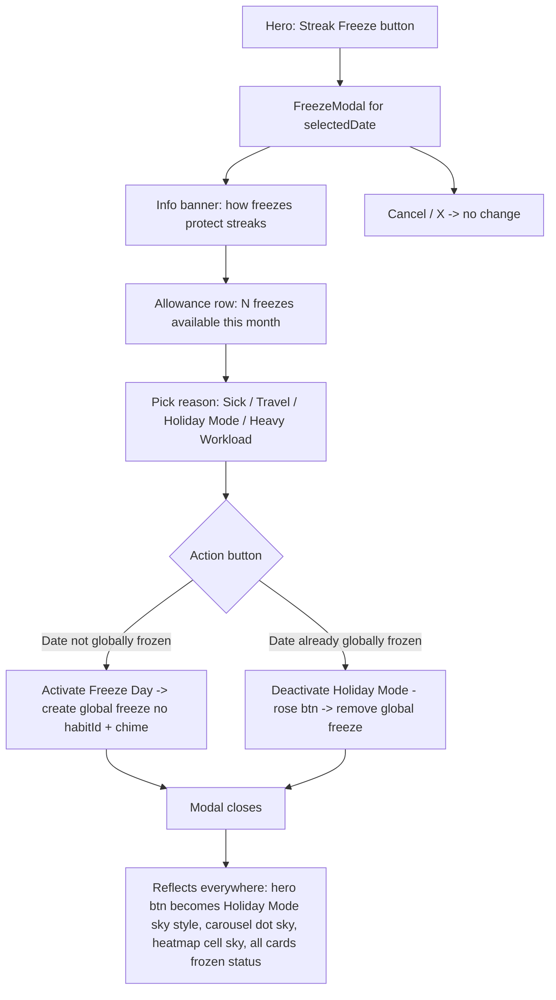

- Allowance counts distinct frozen calendar dates in the month of `selectedDate`, resets on the 1st. ⚠️ Display-only today; Phase 2 must block activation at 0 remaining (AUDIT.md BUG-4).

---

## 10. Analytics & Heatmap

**Surfaces:** Today tab right column and full Analytics tab (same component).

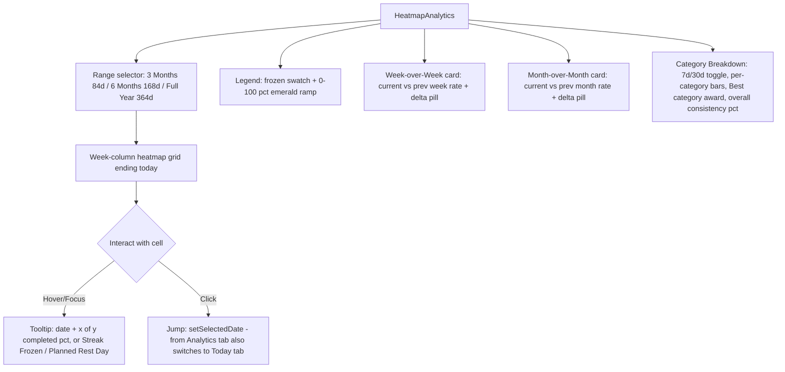

---

## 11. Settings

**Entries:** header gear icon, bottom-nav Settings item, Settings tab → "Configure Settings & Alerts". All open SettingsModal.

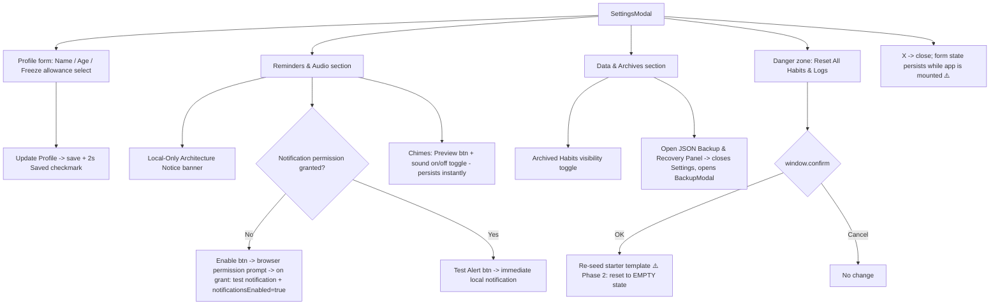

---

## 12. Backup & Recovery

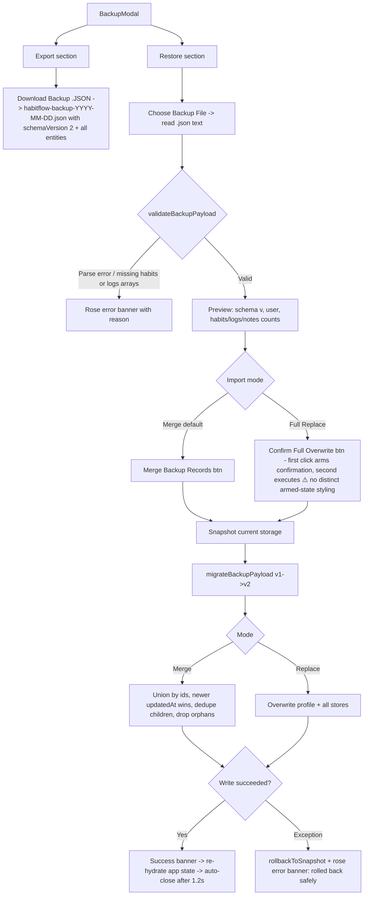

---

## 13. PWA Installation

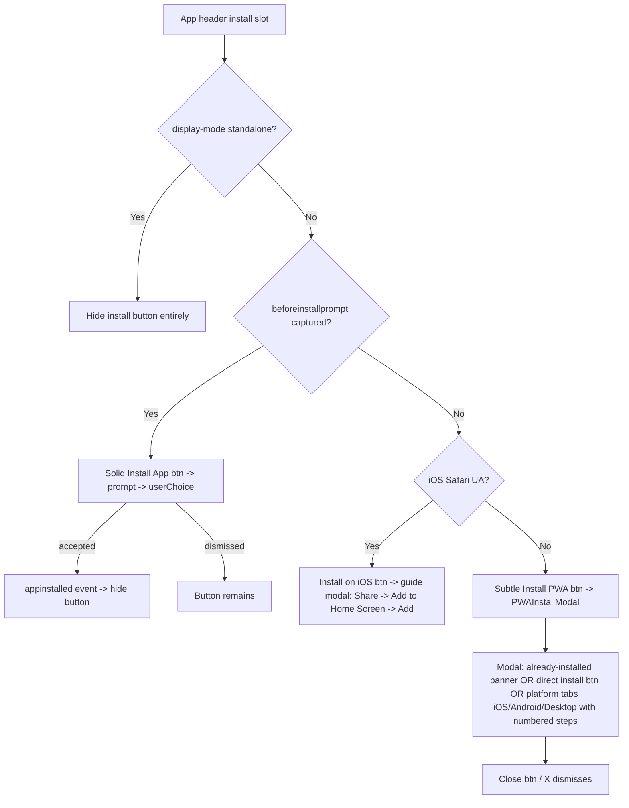

---

## 14. Offline Experience

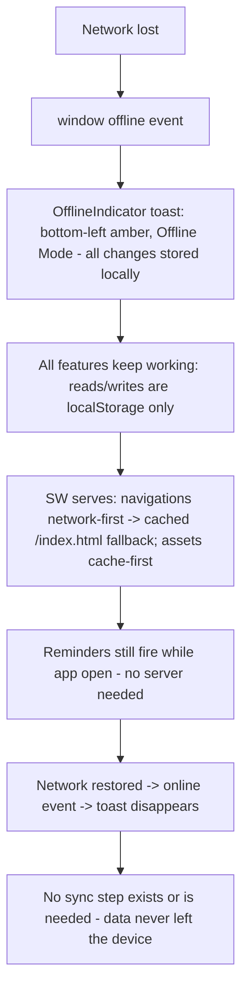

- Cold start offline: precached shell loads; ⚠️ Google Fonts fail (not SW-cacheable cross-origin) → system font fallback per design.md §2.1.

---

## 15. Modal Interaction Contract (all dialogs)

| Behavior | Current standard |
|---|---|
| Open | Rendered when `isOpen`; overlay `bg-slate-950/85 backdrop-blur-md`; panel entrance `animate-in fade-in zoom-in-95` ⚠️ (animation utilities currently no-op, AUDIT.md) |
| Close | X button and Cancel button only. No overlay-click close, no Escape key ⚠️ |
| Confirmation | `window.confirm` for data reset; two-click arm for Full Replace import; **none** for habit delete ⚠️ |
| Validation | Inline rose banners at form top; clear on input change; submit blocked until valid |
| Success | Inline feedback: 2s "Saved" button state (settings), emerald banner + auto-close 1.2s (import), confetti/chimes (completion, onboarding) |
| Error | Rose banners with specific messages (validation, JSON parse, import failure + rollback notice) |
| Stacking | All modals `z-50`; only one modal is open at a time by app state design (Settings → Backup hand-off closes Settings first) |
